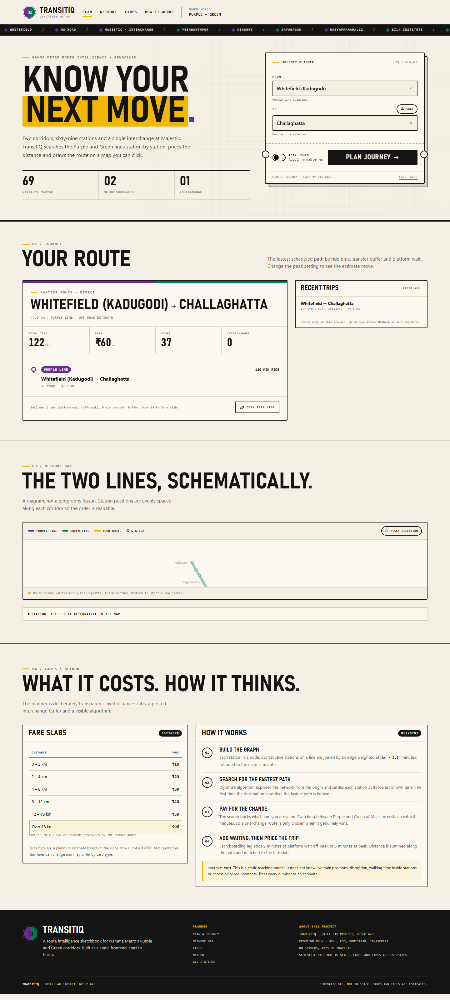
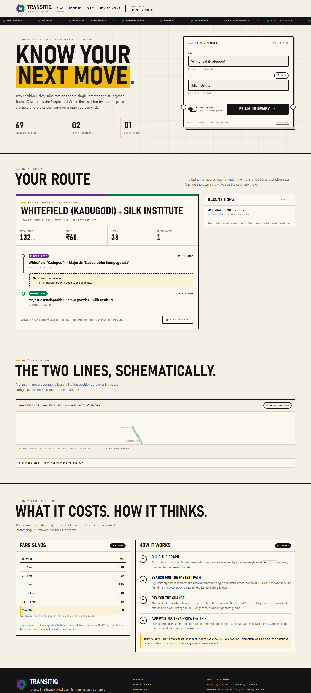
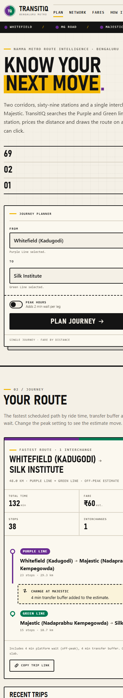
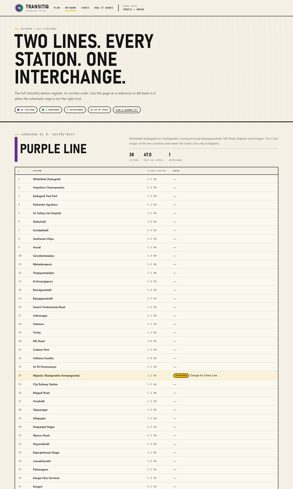

# Project Report — TransitIQ

**Skill Lab · Web Design and Development · L&T EduTech**
*Project 2 of 2*

---

## 1. Group Member Details

| # | Member Name | Email ID |
| --- | --- | --- |
| 1 | Lochan Gowda T M | lochangowda.ad25@bmsce.ac.in |
| 2 | Hanamaraddi Kanakannavar | hanamaraddi.ad25@bmsce.ac.in |
| 3 | N. Pavan | pavan.ad26@bmsce.ac.in |
| 4 | Ganapathi Sai Srinivas | ganapathisai.ad25@bmsce.ac.in |

**GitHub repository:** <https://github.com/lochangowda10/transitIQ>

---

## 2. Project Overview

TransitIQ is a browser-only journey planner for Bengaluru's Namma Metro Purple and Green corridors. It loads a static dataset of 69 real stations in true corridor order, builds a weighted graph in the browser, and finds the fastest path with Dijkstra's algorithm using a binary min-heap. Each leg is priced at `km × 2.5` minutes of ride time, line changes at the single interchange (Majestic) cost a 4-minute transfer buffer, and a peak-hours toggle adds 5-minute platform waits instead of 2-minute ones. The summed route distance maps onto six fare slabs (₹10–₹60), matching the disclosure on the fares panel.

The chosen route is drawn on an interactive SVG schematic map — click the origin, then the destination — and the full trip (legs, distance, time, fare) appears in a results panel. Up to five recent trips persist in `localStorage`. A companion page, `network.html`, is a complete station register: both corridors in order, per-station segment distances, live-computed summary chips, and interchange annotations. No servers, no APIs, no build step; all libraries vendored locally.



## 3. Objectives

1. Model a real transit network faithfully: correct station sequences for both Namma Metro corridors and one shared interchange node (not two duplicated ones).
2. Demonstrate graph search over a hand-built weighted graph, with a transfer penalty so the route is "fastest" in the practical sense, not just shortest in stops.
3. Keep pricing transparent: posted fare slabs, posted wait and transfer constants, and a "How it works" panel that shows the algorithm used — no black-box numbers.
4. Make a complex SVG visualization keyboard- and screen-reader-friendly, with a text-alternative station list outside the map.
5. Practice disciplined pure-frontend engineering: vanilla JavaScript and jQuery over Bootstrap scaffolding, everything computed client-side.

## 4. Expected Outcomes

- The same origin–destination always yields the same fastest path, travel time, and fare for a given peak setting — results are deterministic and explainable from the constants.
- Cross-line journeys (e.g. Whitefield → Silk Institute) pay exactly one 4-minute transfer and switch lines at Majestic, shown leg-by-leg.
- Peak vs off-peak visibly changes the time estimate on the same route while the fare stays distance-based.
- The network page recomputes its summary chips (69 stations, 2 corridors, 1 interchange, network km) from the dataset rather than hardcoding them.
- Both pages load with zero console errors and zero network requests beyond their own vendored assets.

## 5. Design Sections

### 5.1 Layout and information architecture

`index.html` is a single scrolling page in numbered sections: hero with the journey-planner ticket, journey results, network map, then fares and method. `network.html` is a reference page with one block per corridor. The planner ticket frames the search like a metro ticket — notches, a reference number, and fields for From/To — which anchors the whole visual identity.

### 5.2 Visual design

An ink-and-paper transit aesthetic: warm off-white stock, near-black text, and the two corridor colours (Purple `#6A2C91`, Green `#007A53`) used as the only accents. A station-name ticker runs under the header. The logo is an inline SVG roundel split half-purple, half-green. Typography leans dense and condensed, in the spirit of metro signage.



### 5.3 Data design

`js/data.js` holds each corridor as an ordered list of stations with an approximate `kmToNext` (≈1.0–1.6 km, explicitly labelled as project estimates, not official BMRCL figures). A builder assigns order numbers and totals; a registry merges Majestic into a single node flagged `interchange: true` so both sequences share one graph node. Six fare slabs and the model constants (ride rate, transfer penalty, waits) ship with the dataset in one place.

### 5.4 Search design

`js/app.js` builds an adjacency list keyed by a `(station, line)` state pair, which is what lets the search track *which line you arrive on* and charge the transfer penalty only on an actual line change. Dijkstra runs from the origin, relaxing edges through a MinHeap; when the destination settles, the path is reconstructed and sorted into consecutive legs marked Purple / Green / Transfer. Waits are added per boarding leg, then distance is summed and matched to a slab.

### 5.5 Map and interaction design

The SVG map distributes stations evenly along each corridor (readable order, not geography), with interchange bridges at Majestic. Stations are focusable; hover/focus shows a tooltip (also `aria-describedby`-linked), click sets origin then destination, and a "Reset selection" returns to neutral. A `details`/`summary` text list provides a full non-visual alternative. Both station fields are ARIA comboboxes with keyboard filtering, arrow navigation, and a clear button.

### 5.6 State and accessibility

Recent trips (max five) persist under the `localStorage` key `transitiq.recent.v1` with a graceful degrade if storage is blocked, plus a "Clear all" action. ARIA-wise: `role="alert"` errors, `aria-live` results, `aria-expanded` comboboxes, `aria-current` navigation, skip link, focus rings, and reduced-motion support. Errors are inline, never `alert()` popups. A `noscript` notice explains that the planner requires JavaScript.



## 6. Code Snippets

The min-heap that keeps Dijkstra at polling time:

```js
function MinHeap() {
  var a = [];
  this.push = function (node, priority) {
    a.push({ node: node, p: priority });
    var i = a.length - 1;
    while (i > 0) {
      var p = (i - 1) >> 1;
      if (a[p].p <= a[i].p) break;
      /* swap and continue up */ i = p;
    }
  };
  /* ...pop() mirrors it downward... */
}
```

The transfer penalty is a property of *arrival state*, so a turnback that must change lines pays only once:

```js
var stateKey = stationId + '|' + lineId;     // explicit (station, line) state
addEdge(from, to, minutes, fromLineId, km);
/* switching line at Majestic costs DATA.transferPenaltyMin (4 min) */
```

Fare lookup over the slabs:

```js
function getFareSlab(km) {
  for (var i = 0; i < DATA.fareSlabs.length; i++) {
    if (km >= DATA.fareSlabs[i].min && km < DATA.fareSlabs[i].max)
      return DATA.fareSlabs[i];
  }
}
```

## 7. Screenshots

| Screenshot | View |
| --- | --- |
| `assets/screenshots/01-home.png` | Planner hero with journey ticket |
| `assets/screenshots/02-crossline.png` | Cross-line route rendered leg-by-leg |
| `assets/screenshots/03-network.png` | Station register (network page) |
| `assets/screenshots/04-mobile.png` | Mobile layout |



## 8. Technology Used

- HTML5, CSS3, Bootstrap 5.3.3, jQuery 3.7.1 — all vendored locally, no CDN
- Vanilla JavaScript (ES5 style): weighted graph + Dijkstra with a binary min-heap, inline SVG rendering, ARIA combobox pattern, `localStorage`, URL state cleanup via `history.replaceState`
- No servers, trackers, or build steps

## 9. Testing Performed

- `node --check` on `js/app.js` and `js/data.js`
- Both pages served locally and loaded in headless Chrome: no console errors, no failed/external requests
- DOM checks: 69 `.map-station` nodes rendered, both station tables fully populated, summary chips computed live, 3 sample journeys present
- Encoding hygiene verified byte-level after a repair: the network page now renders `— – ₹ → ·` correctly with no residual mojibake
- All passenger-facing text mirrors the model constants, so displayed math and applied math agree

## 10. Limitations

- A static teaching model: no live train positions, disruptions, in-station walking time, accessibility requirements, or real BMRCL timetables.
- Segment distances and ride times are estimates; the schematic map is not to scale.
- Recent trips live only in one browser's `localStorage`; nothing syncs or leaves the machine.
- Fares track the posted slab model, not an official BMRCL quotation.

## 11. How to Run

```powershell
cd projects/transitiq
python -m http.server 8125
```

Open <http://localhost:8125/>. (Opening `index.html` directly also works.)

---

*TransitIQ — a Skill Lab project. Built with HTML, CSS, Bootstrap 5.3.3, and jQuery 3.7.1. All libraries are local.*
